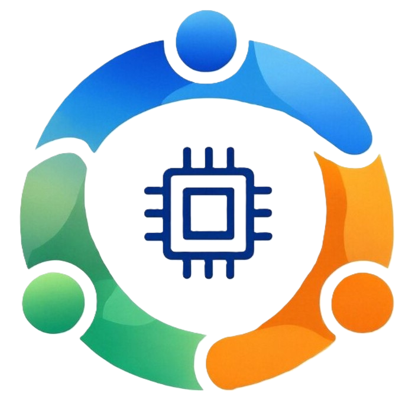

<div align="center">



# HUUC-EAA · 电子爱好者协会官网

**河南城建学院电气工程学院 · 电子爱好者协会（Electronics Enthusiasts Association）**

复古未来主义终端美学（CRT Terminal Geek）风格的社团单页官网
ASCII 字符画 · 二进制数据流 · PCB 蚀刻板艺术 · 全屏滚动吸附

[Next.js 16](https://nextjs.org) · [React 19](https://react.dev) · [TypeScript](https://www.typescriptlang.org) · [Tailwind CSS v4](https://tailwindcss.com)

[加入我们](https://qm.qq.com/q/Hkm2TOefa8) · [GitHub 组织](https://github.com/HUUC-EEA) · [公共账号](https://github.com/HUUCEEA) · [设计文档](docs/网站设计文档.md)

</div>

---

## 关于我们

电子爱好者协会是**河南城建学院电气工程学院**旗下的技术社团，也是学校为数不多以**电子信息技术**为主的协会。
我们背靠学院 **2A109 实验室**，在指导老师**徐娟**老师的带领下，为全校电子数码爱好者搭建一个交流平台：
一起研究嵌入式开发、讨论技术难题，也会组织下乡等各类电子爱好活动。

我们的理念不止于校园——更想把社团打造成学院与学校的品牌，加强校园网络和电子科技文化的传播与建设。
欢迎各学院的技术人才加入我们。

| 项目 | 内容 |
| --- | --- |
| 社团名称 | 电子爱好者协会（HUUC-EAA / EEA） |
| 所属学校 | 河南城建学院 · 电气工程学院 |
| 活动基地 | 电气工程学院 2A109 实验室 |
| 指导老师 | 徐娟 |
| 研究方向 | 嵌入式开发 · 硬件设计 · 技术讨论 |
| QQ 群 | `246625562`（[一键加群](https://qm.qq.com/q/Hkm2TOefa8)） |
| 邮箱 | [eea@huuc.top](mailto:eea@huuc.top) |
| 域名 | [eea.huuc.top](https://eea.huuc.top) |

## 网站一览

单页应用，五个全屏区块 + HUD 页脚，`scroll-snap` 逐屏吸附：

| 区块 | 锚点 | 内容 |
| --- | --- | --- |
| Hero 终端首屏 | `#home` | 串口引导行打字机 → ASCII 星环行星 → `HUUC-EAA` 字符主标题 → 原理图分割线 → 中文副标题；鼠标电磁探针让 ASCII 字符偏移、高亮、乱码闪变，行星与标题随鼠标视差位移 |
| 系统配置 | `#neofetch` | 仿 Linux KDE Konsole 窗口：程序化生成的社团 Logo ASCII 画（50×24）+ 21 行 neofetch 配置项 + 终端 16 色板，滚入视口时约 1 秒快速「fetch」打出 |
| 关于我们 | `#about` | 程序化生成的 **PCB 蚀刻板艺术图**（Manhattan + 45° 走线、焊盘、过孔、QFP 芯片、描边字标），滚入视口时走线逐条蚀刻显现；右栏协会简介与丝印风格信息表 |
| 社团仓库 | `#repo` | GitHub 项目仓库 / 公共账号 / 组织三入口，悬停描边转磷光绿 |
| 加入我们 | `#join` | 终端指令式 CTA（`$ ./join --huuc-eea --now`）+ QQ 群信息，全站所有「加入我们」统一跳转加群链接 |

### 设计语言

**Retro-Futuristic Terminal Aesthetics（复古未来主义终端美学）**，融合三种气质：

- **ASCII Brutalism**：摒弃装饰图片，直接暴露等宽字体网格、ASCII 字符画、`0/1` 数据流与十六进制坐标
- **Cyber-Schematic Minimalism**：示波器方波、`TX ▲ / RX ▼` 总线信号与电路原理图分割线的克制表达；二进制数据流桌面端为左右两栏、移动端变为上下两条横带，并按区块切换 正常 / 压暗模糊 / 隐藏，滚动时 14x 冲刺后回落
- **CRT 质感**：全站 3px 扫描线 + 暗角滤镜层，标题带 P31 磷光辉光

| 色彩 | 色值 | 用途 |
| --- | --- | --- |
| CRT 深黑底 | `#050706` | 全局背景 |
| P31 磷光绿 | `#38EF7D` | 主强调：CTA、链接悬停、TX 数据流、ASCII 高亮 |
| 示波器青 | `#00F5D4` | 次强调：RX 数据流、校验通过状态、探针高亮 |
| 徽章蓝 | `#58A6FF` | 导航栏 `HUUCEEA` 徽章 |

**字体分工**（全站自托管，不依赖外网字体服务）：

| 字体 | 用途 |
| --- | --- |
| JetBrains Mono Variable | 等宽打底，ASCII 艺术与英文标注 |
| Noto Sans SC Variable | 中文正文 |
| 得意黑 Smiley Sans Oblique | 中文标题（窄斜黑体的「极客海报」感） |
| 融合像素 Fusion Pixel 12px | 导航栏品牌 / 菜单 / CTA（按站点用字裁剪为 ~22KB 子集） |
| Share Tech Mono | `ABOUT_US` / `REPOSITORY` 等英文小标签 |

## 技术栈

| 类别 | 选型 |
| --- | --- |
| 框架 | Next.js 16.4（App Router · Turbopack · Cache Components · 静态预渲染） |
| UI | React 19 + TypeScript 5 + Tailwind CSS v4（`@theme` 设计令牌） |
| 图形 | Canvas 2D 程序化二进制数据流；SVG `pathLength` + `stroke-dashoffset` 蚀刻动画；固定种子 mulberry32 保证 SSR/水合一致 |
| 字体 | @fontsource 自托管 + `subset-font` 子集管线（`npm run fonts:subset`） |
| 动效 | CSS scroll-snap 全屏吸附、打字机序列、鼠标探针 / 视差，全部尊重 `prefers-reduced-motion` |
| 后端规划 | FastAPI（社员简介、技术博客与项目展示，待开发） |

### 加载优化

- **区块加载隔离**：neofetch 区块拆为独立 chunk，滚到距视口 1.6 屏内才下载挂载，占位为等高骨架避免吸附跳动
- **运行时隔离**：Hero 探针循环滚离首屏即暂停；背景数据流在 `requestIdleCallback` 空闲初始化
- **字体瘦身**：像素字体子集 ~22KB、得意黑按用字裁剪至 ~104KB 分片，首屏字体 `preload`
- **实测**：生产首屏传输 JS 148.6KB / CSS 43.2KB / 8 个 JS 请求，控制台零告警

## 项目结构

```
app/
├── layout.tsx               # 根布局：字体自托管引入、图标约定、preload
├── page.tsx                 # 五个 SnapSection 区块编排
├── links.ts                 # 全站统一外链常量（JOIN_URL）
├── globals.css              # 设计令牌、CRT 滤镜、蚀刻动画等全局样式
├── fonts/smiley-sans.css    # 得意黑子集分片（脚本生成）
├── icon1/2.png, favicon.ico, apple-icon.png  # 站点图标（协会 logo）
└── components/
    ├── TerminalBackdrop.tsx # CRT 扫描线 + TX/RX 二进制数据流 Canvas
    ├── HeroTerminal.tsx     # 首屏打字机序列 + 鼠标探针 / 视差
    ├── NeofetchTerminal.tsx # 仿 Konsole neofetch 模块（懒加载）
    ├── PcbAbout.tsx         # 程序化 PCB 蚀刻板艺术图
    ├── DeferredMount.tsx    # 区块级加载隔离
    ├── SnapSection.tsx      # 全屏滚动吸附区块
    ├── Navbar.tsx           # 极客导航栏（下滑隐藏 / 移动抽屉）
    └── Footer.tsx           # HUD 状态栏页脚
scripts/subset-fonts.mjs     # 像素字体 + 得意黑子集生成管线
docs/网站设计文档.md          # 完整设计文档（设计语言 / 配色 / 字体 / 区块 / 组件）
```

## 快速开始

```bash
npm install
npm run dev        # http://localhost:3000
npm run build      # 生产构建
npm run start      # 生产服务
```

修改了站点中文文案后，重新生成字体子集（像素字体与得意黑分片）：

```bash
npm run fonts:subset
```

## 参与我们

- 加 QQ 群 `246625562`（[一键加群](https://qm.qq.com/q/Hkm2TOefa8)），零基础新生到硬件极客都欢迎
- 社团代码、图纸与文档全部开源：[项目仓库](https://github.com/HUUC-EEA/EEA) · [公共账号](https://github.com/HUUCEEA) · [GitHub 组织](https://github.com/HUUC-EEA)，欢迎 Star / Fork / 提 PR

## 致谢与许可

- 网页制作人：**ShanyJin**
- 字体许可：融合像素 Fusion Pixel、得意黑 Smiley Sans、JetBrains Mono、Noto Sans SC、Share Tech Mono 均为 SIL Open Font License / Apache 开源许可
- 更详细的设计说明见 [docs/网站设计文档.md](docs/网站设计文档.md)
